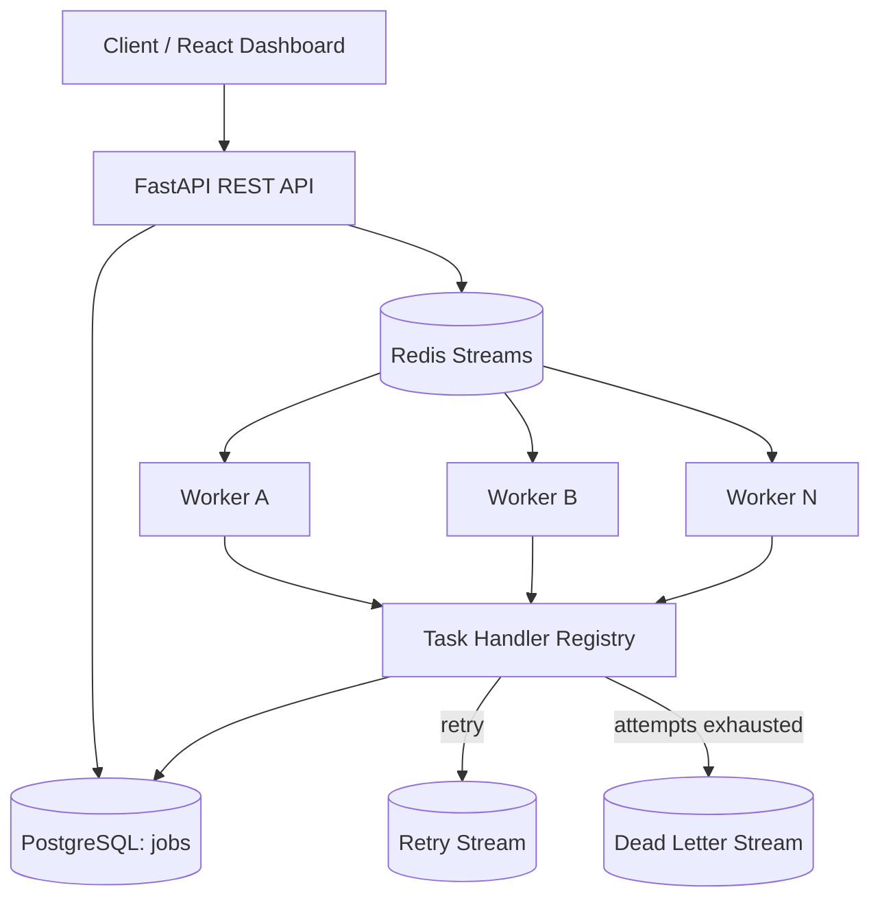

# PulseQ — Architecture & System Design

## 1. Problem statement

A synchronous web request should not need to wait for slow background operations. If an application performs email delivery, invoice generation, media processing, or webhook delivery inside its request-response path, user-facing latency and availability become dependent on every downstream operation.

PulseQ accepts work quickly, persists its state, and executes it asynchronously using independently scalable workers.

## 2. Goals and non-goals

### Goals
- Fast job submission API.
- Separate API and worker scaling.
- Persistent job lifecycle state.
- Multiple consumers using Redis Streams consumer groups.
- Bounded retries with exponential backoff.
- Dead-letter handling for exhausted jobs.
- Idempotency key for duplicate client submissions.
- Observable job status and basic queue metrics.

### Non-goals in this starter
- Exactly-once execution (not generally achievable across arbitrary side effects).
- Multi-region active-active operation.
- Guaranteed execution at an exact scheduled time.
- Multi-tenant enterprise authorization.
- Production-grade secrets, migrations, and disaster recovery.

## 3. High-level architecture



## 4. Component responsibilities

| Component | Responsibility |
|---|---|
| React dashboard | Submit jobs, inspect status and metrics |
| FastAPI | Validation, authentication, job creation, status queries |
| PostgreSQL | Source of truth for job metadata and lifecycle |
| Redis Streams | Dispatch messages to consumer groups |
| Worker | Claim messages, execute handlers, acknowledge messages |
| Handler registry | Maps task type to safe application function |
| Retry stream | Holds jobs scheduled for a later retry (promotion loop is a future milestone) |
| DLQ stream | Records jobs that have exhausted attempts |

## 5. Job lifecycle

```text
queued -> running -> succeeded
                  -> retrying -> queued (future promotion)
                  -> dead_letter
```

The current starter implements immediate re-publication for retry attempts to keep the runnable example compact. A production implementation should use a delayed retry sorted set or dedicated scheduler to enforce backoff before re-queueing.

## 6. Data model

`jobs` contains:
- `id`: UUID primary key.
- `task_type`: allow-listed handler identifier.
- `payload`: JSON input.
- `status`: queued, running, succeeded, retrying, dead_letter.
- `priority`: integer 1–10.
- `attempts`, `max_attempts`: retry counters.
- `idempotency_key`: optional unique client key.
- `created_at`, `updated_at`, `scheduled_for`.
- `result`, `last_error`.

PostgreSQL is the durable record. Redis is the dispatch mechanism, not the only record of job state.

## 7. API design

| Method | Endpoint | Purpose |
|---|---|---|
| POST | `/jobs` | Submit a job |
| GET | `/jobs` | List recent jobs |
| GET | `/jobs/{job_id}` | Get job detail |
| GET | `/metrics` | Basic job counts |
| GET | `/health` | Liveness / dependency health |

All application endpoints except `/health` require `X-API-Key` in this starter. Replace the development key before sharing or deploying.

## 8. Reliability concepts

### At-least-once delivery
A worker may execute a message and crash before acknowledging it. The broker can deliver it again. Therefore a task handler must be idempotent, or use an idempotency key with the downstream system.

### Idempotent submission
A client can send the same `Idempotency-Key` more than once. The API returns the existing job instead of creating a duplicate. This protects submission retries, not arbitrary side effects inside handlers.

### Retry and dead-letter queue
Transient errors may succeed on a later attempt. After the configured maximum attempts, the job is marked `dead_letter` and written to a DLQ stream for inspection.

### Worker heartbeat
Workers periodically update a Redis key. The dashboard can expose worker liveness in a later iteration. A heartbeat alone does not safely recover jobs; recovery must reconcile worker state, pending stream entries, and PostgreSQL state.

### Dual-write risk
The API writes to PostgreSQL and Redis separately. A crash between these operations can leave a queued database row without a broker message. Production design: use the **transactional outbox pattern**. Insert job and outbox event in one DB transaction; a publisher reliably forwards outbox events to Redis and marks them delivered.

## 9. Scalability

- Scale API replicas horizontally behind a load balancer.
- Scale workers independently according to queue lag and processing time.
- Use multiple Redis consumer groups only when independent subscribers need each event; for competing workers use one group with multiple consumers.
- Partition queues by workload (email, reports, media) to isolate noisy neighbors.
- Apply per-tenant concurrency limits and admission control.
- Use PostgreSQL indexes, connection pooling, retention policies, and archival.
- Monitor queue age, pending entries, retry rate, DLQ growth, worker utilization, p50/p95/p99 latency, and throughput.

## 10. System-design trade-offs

| Decision | Benefit | Cost / trade-off |
|---|---|---|
| Redis Streams | Consumer groups and pending-entry tracking | Redis operations and recovery logic required |
| PostgreSQL state | Durable queries and reporting | DB can become a bottleneck |
| At-least-once | Better recovery from worker crashes | Duplicate execution possible |
| Separate workers | Independent scaling | More deployment and monitoring complexity |
| Retry | Handles transient failures | Can amplify load during outages |
| DLQ | Isolates poison messages | Requires operational replay tooling |

## 11. Testing strategy

- Unit tests: validation, retry delay, handler behavior.
- API tests: authentication, submission, idempotency, status.
- Integration tests: real Redis and PostgreSQL.
- Failure tests: kill a worker during execution; verify pending work recovery.
- Load tests: ramp concurrent submissions and measure throughput / p95 latency.
- Soak tests: sustained workload and memory / queue growth.

## 12. Production readiness checklist

- [ ] Transactional outbox and publisher.
- [ ] Delayed retry scheduler and jitter.
- [ ] `XAUTOCLAIM` / pending-message recovery.
- [ ] Graceful worker shutdown and visibility timeout strategy.
- [ ] Alembic migrations and DB connection pooling.
- [ ] API rate limits, RBAC, tenant isolation, audit logs.
- [ ] Metrics exporter, dashboards, tracing, structured logs.
- [ ] TLS, secret manager, network policy, backups.
- [ ] Load, chaos, and disaster-recovery tests.
- [ ] Documented SLOs and operational runbooks.
